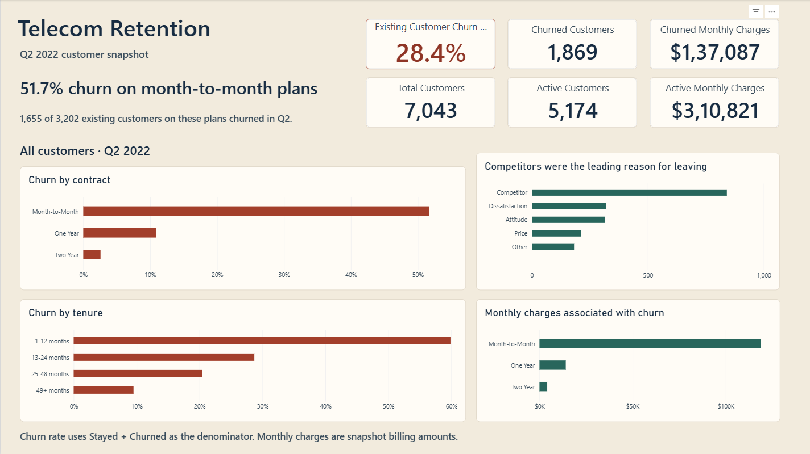
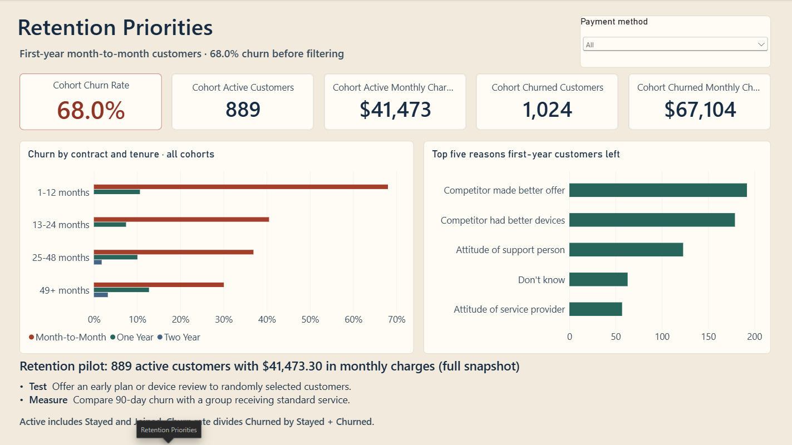

# Telecom Churn & Retention Analytics

     

A PostgreSQL 16 and Power BI project that analyzes a Q2 2022 snapshot of **7,043 telecom customers**, identifies a high-churn segment, and proposes a measurable retention pilot.

**Pipeline:** Source CSVs → PostgreSQL staging and analysis views → customer-level CSV → Power Query → DAX and Power BI.

**Skills demonstrated:** SQL (CTEs, window functions, and conditional aggregation), Power Query, DAX, cohort analysis, KPI design, and data visualization.

## Dashboard previews

### Churn Overview



### Retention Priorities



## Dataset

The dataset represents a fictional California telecom provider. It was published by Maven Analytics, sourced from IBM Cognos Analytics, and listed as public domain. [Telecom Customer Churn dataset](https://mavenanalytics.io/data-playground/telecom-customer-churn)

## Project structure

| Path | Contents |
| --- | --- |
| [PowerBI/](PowerBI/) | Desktop project, report pages, theme, and semantic model |
| [sql/](sql/) | PostgreSQL setup, analysis views, and the Power BI source view |
| [data/raw/](data/raw/) | Source customer snapshot, ZIP population lookup, and data dictionary |
| [data/processed/](data/processed/) | Customer export used by Power BI |
| [docs/images/](docs/images/) | Power BI screenshots for the README |

## Report pages

| Page | Business question |
| --- | --- |
| Churn Overview | Where is churn concentrated, and what monthly charges are associated with churned customers? |
| Retention Priorities | How does churn vary across contract and tenure combinations, and what can we learn from customers who left in their first year on a month-to-month plan? |

The Retention Priorities page includes a payment-method slicer. The contract and tenure chart compares segments across the snapshot. The five KPI cards and churn-reasons chart focus on customers with 1–12 months of tenure and a month-to-month contract.

## Findings

- **28.4% existing-customer churn overall** (1,869 of 6,589). The overall snapshot includes another 454 customers who joined during the quarter.
- **51.7% churn on month-to-month contracts**, rising to **68.0%** for first-year customers on those contracts (1,024 of 1,505 existing customers).
- **889 active customers** were in the first-year month-to-month segment, with **$41,473.30** in monthly charges. A better competitor offer was the most reported churn reason (192 customers), followed by better competitor devices (179).

## Recommended retention pilot

Start with active first-year month-to-month customers. The Q2 snapshot identifies **889 active customers** with **$41,473.30 in monthly charges**. Test an early plan or device review because better competitor offers and devices were the two most reported reasons for leaving this cohort.

Randomly assign eligible active customers to outreach or standard service. Compare the share who churn within 90 days, using everyone assigned to each group as its denominator. Monitor offer costs alongside churn. The snapshot sizes the eligible cohort. Measuring the pilot requires follow-up customer status.

## KPI definitions

- **Existing-customer churn rate** = Churned ÷ (Stayed + Churned).
- **Active customers** = Stayed + Joined.
- **Monthly charges** are summed from snapshot billing amounts. The dataset supports segment comparisons for a single quarter.

## Open and refresh the report

Open `PowerBI/Telecom_Churn.pbip` in Power BI Desktop. In **Transform data**, select **Customers** and update the file path in the **Source** step to the absolute path of `data/processed/power_bi_customers.csv` in your clone. Select **Close & Apply** and refresh. The CSV is included, so PostgreSQL is only needed to rebuild the export.

## Rebuild the customer export

Put the Maven source CSVs in `data/raw/` using the filenames referenced by the baseline script. Create a database named `telecom_churn` if needed. Run these commands from the project root using PostgreSQL 16.

```powershell
New-Item -ItemType Directory -Force data/processed | Out-Null
psql -X -d telecom_churn -v ON_ERROR_STOP=1 -f sql/telecom_baseline.sql -f sql/churn_by_contract_and_tenure.sql -f sql/churn_reasons_by_cohort.sql -f sql/first_year_month_to_month_retention.sql -f sql/power_bi_customers.sql
psql -X -d telecom_churn -v ON_ERROR_STOP=1 -c "\copy (SELECT * FROM telecom.power_bi_customers ORDER BY customer_id) TO 'data/processed/power_bi_customers.csv' CSV HEADER"
```
